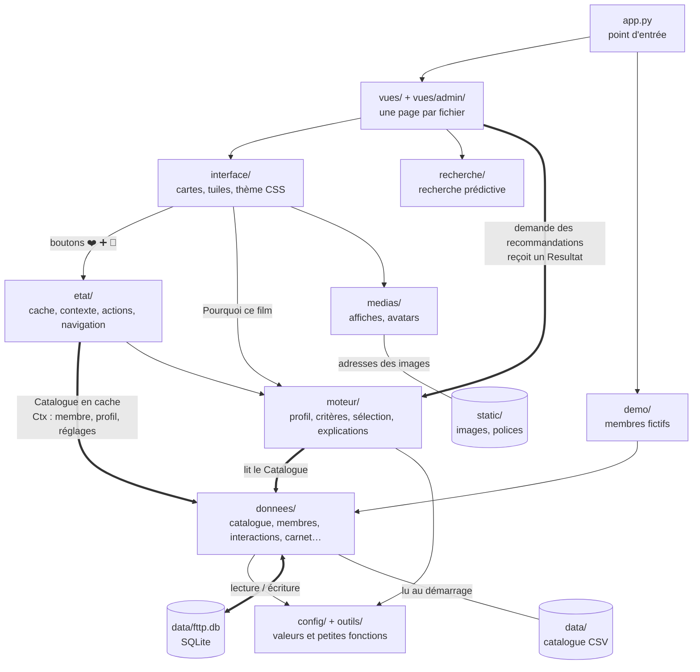

# Forward To The Past — comprendre et modifier le code

> Pour lancer l'app et découvrir ses écrans : `README.md`.
> Ce document explique **comment le code est rangé**, **où modifier quoi**, et **comment vérifier** qu'une modification n'a rien cassé.
> Schéma interactif : ouvrir `architecture.html` dans un navigateur. Bugs et risques connus : `BUGS_ET_RISQUES.md`.
> **Apparence** (couleurs, polices, tailles, alignements, contours, arrondis, ombres…) : ouvrir `GUIDE_PERSONNALISATION.html` dans un navigateur — 👆 toucher l'élément sur la capture de l'écran, choisir quoi changer : page, `fichier:ligne` et ligne à coller.

---

## 1. En 30 secondes

- L'app est un **site Streamlit**. À chaque clic, Streamlit relance `app.py` de haut en bas : il lit la base, calcule les recommandations et redessine la page.
- Le code est rangé **par rôle**, un dossier par rôle. Chaque fichier commence par un en-tête qui dit **à quoi il sert**, **ce qu'il utilise** et **qui l'utilise**. Chaque fonction a une phrase qui dit ce qu'elle fait.
- **Règle d'or : les appels descendent, ils ne remontent jamais.** Une page (`vues/`) peut appeler le moteur ; le moteur n'appelle jamais une page. C'est vérifié : aucune dépendance circulaire.

```
app.py ─► vues/ ─► interface/ · recherche/ ─► etat/ · demo/ ─► moteur/ ─► donnees/ · medias/ ─► outils/ · config/
 (page)   (écrans)  (briques d'affichage)      (session)        (calculs)   (base, CSV, images)    (valeurs, petites fonctions)
```
On peut sauter une couche (une page peut lire `config/` directement). Deux appels « en travers » sont autorisés : `interface → etat` (une carte film porte ses boutons ❤️) et `interface → moteur` (une carte affiche « Pourquoi ce film »).

---

## 2. Lancer l'app et le contrôle

### L'app (terminal VS Code, Windows)
```powershell
cd "C:\chemin\vers\Forward_To_The_Past"
.\.venv\Scripts\Activate.ps1            # environnement créé une fois (voir README)
python -m streamlit run app.py          # → http://localhost:8501
```
| Besoin | Commande |
|---|---|
| Recréer les membres fictifs | `python -m demo.generation --nb 180 --reset` |
| Utiliser une autre base | variable d'environnement `FTTP_BDD` = chemin du fichier `.db` (sinon `data/fttp.db`) |
| Mot de passe admin réel | `.streamlit/secrets.toml` → `ADMIN_MDP = "…"` (sinon variable `FTTP_ADMIN_MDP`, sinon « 007 » de démo) |

### Le contrôle de non-régression (kit `controle_fttp`, à côté du projet)
Il compare votre version à la V9 de référence : mêmes calculs, même affichage au pixel près.
```powershell
cd "C:\chemin\vers\FTTP\controle_fttp"
python controler.py --reference ..\Forward_To_The_Past_v9 --candidat ..\Forward_To_The_Past --golden-seul   # calculs, ≈ 15 s
python controler.py --reference ..\Forward_To_The_Past_v9 --candidat ..\Forward_To_The_Past                 # complet, ≈ 20 min
python controle_demo.py --reference ..\Forward_To_The_Past_v9 --candidat ..\Forward_To_The_Past             # base de démo
python controle_admin.py  ..\Forward_To_The_Past_v9 ..\Forward_To_The_Past ..\Forward_To_The_Past_v9\data\fttp.db  # boutons de l'admin
python controle_ecrans.py ..\Forward_To_The_Past_v9 ..\Forward_To_The_Past ..\Forward_To_The_Past_v9\data\fttp.db  # inscription, carnet
```
Résultat : `resultats_controle\rapport.md`. ✅ CONFORME = rien n'a changé. 🟡 BRUIT = quelques pixels qui varient aussi d'une capture à l'autre de la V9 elle-même (sans conséquence). ❌ = un écart reproduit : à examiner. Détails : `LISEZMOI.md` du kit.

**Quand une modification change volontairement l'app** (nouveau texte, nouvelle couleur…), le contrôle doit signaler un écart : c'est normal. La nouvelle version devient alors la référence.

---

## 3. Schéma d'ensemble

Flèche = « appelle » (toujours vers le bas). Flèche épaisse = un appel qui transporte les données principales. Trait sans flèche = fichier lu sur le disque.



---

## 4. Le trajet d'un clic ❤️ (de bout en bout)

| # | Ce qui se passe | Fichier · fonction |
|---|---|---|
| 1 | Le membre clique ❤️ sous une jaquette | `interface/cartes.py` · `reactions` (bouton Streamlit, `on_click=basculer`) |
| 2 | Le clic est traité avant de redessiner la page | `etat/actions.py` · `basculer` |
| 3 | La base enregistre le j'aime (et retire un éventuel 🤮 ou ➕ du même film) | `donnees/interactions.py` · `basculer` |
| 4 | L'action est notée au journal ; un message « ❤️ Ajouté à tes coups de cœur · +5 XP » est mis en attente | `donnees/journal.py` · `journaliser` · `etat/actions.py` · `annoncer` |
| 5 | Streamlit relance `app.py` | `app.py` · `main` |
| 6 | Le cache de la communauté voit qu'une interaction a changé et se recalcule | `etat/cache.py` · `communaute` (clé `donnees/interactions.py` · `version_communaute`) |
| 7 | Le contexte relit le membre : préférences, interactions, carnet | `etat/contexte.py` · `construire` |
| 8 | Le profil moteur intègre le nouveau film aimé (les actions récentes pèsent plus) | `moteur/profil_membre.py` · `profil_membre` |
| 9 | La page « Pour toi » redemande ses recommandations | `vues/accueil.py` · `afficher` → `moteur/recommandation.py` · `pour_toi` |
| 10 | Chaque critère note chaque film (0 à 1), pondéré par les réglages de l'admin | `moteur/recommandation.py` · `_critere_genre`, `_critere_histoire`… |
| 11 | Les meilleurs films sont choisis en évitant les quasi-doublons (diversité) | `moteur/selection.py` · `selectionner` |
| 12 | Les cartes s'affichent avec leur raison (« 🎭 Tu aimes : Comédie ») et le message de l'étape 4 | `interface/cartes.py` · `grille` · `moteur/explications.py` · `pourquoi` · `etat/actions.py` · `afficher_toasts` |

---

## 5. Je veux modifier… → fichier

| Je veux modifier… | Fichier | Où exactement |
|---|---|---|
| Une couleur de l'app (rose, turquoise, fond…) | `interface/style/01_polices_et_base.css` | variables `--ft-…` en haut du fichier |
| Les couleurs des graphiques | `config/affichage.py` | `PALETTE_NEON`, `COULEURS_BARRES`, `COULEURS_CRITERES`, `DEGRADE_CHALEUR` |
| Le style d'une zone de l'écran | `interface/style/NN_<zone>.css` | liste des zones dans `interface/theme.py` (`ZONES`). Relancer l'app après une modification `.css` |
| L'affichage mobile | `interface/style/mobile.css` | et les couples `(ordinateur, mobile)` de `config/affichage.py` |
| Le nombre de films par rangée ou par page | `config/affichage.py` | `FILMS_PAR_RANGEE`, `FILMS_PAR_PAGE_EXPLORER`, `LIGNES_PAR_PAGE_MES_FILMS`… |
| Le texte d'un bouton ou d'un titre | le fichier de la page (`vues/…`) | les textes utilisés une seule fois restent à côté de leur bouton |
| Une liste de choix (tris, humeurs, années cultes, onglets…) | `config/libelles.py` | `TRIS_*`, `HUMEURS`, `SAUTS_DANS_LE_TEMPS`, `ONGLETS_MES_FILMS`… |
| L'emoji d'un genre | `config/affichage.py` | `EMOJI_GENRE` |
| Les messages après ❤️ ➕ 🤮 | `config/messages.py` | `MESSAGES` |
| Les réglages d'usine du moteur, les curseurs de l'admin, les profils prêts à l'emploi | `config/reglages_moteur.py` | `PARAMS_DEFAUT`, `REGLAGES`, `PRESETS` |
| Le calcul d'un critère (genre, époque, histoire…) | `moteur/recommandation.py` | `_critere_…` (Pour toi) ou `similaires` (Tu as aimé…) |
| Ajouter un critère au moteur | `config/reglages_moteur.py` + `moteur/recommandation.py` + `moteur/explications.py` | nom dans `COMPOSANTES` et `REGLAGES`, calcul dans les deux modes, phrase dans `_PHRASES` |
| La diversité, le calibrage, la règle saga | `moteur/selection.py` | `_choix_diversifie`, `_candidats`, `_regle_saga` |
| Une phrase « Pourquoi ce film ? » | `moteur/explications.py` | `_phrase_<critère>` |
| Le poids des actions récentes | `moteur/profil_membre.py` | `poids_recence` |
| Une rubrique de l'accueil (ajouter, retirer, réordonner) | `vues/accueil.py` | une fonction par rubrique, appelées dans l'ordre par `afficher` |
| Ajouter une page | `vues/<page>.py` + `app.py` | fonction `afficher(ctx)` + une ligne dans `PAGES` |
| Un onglet de l'admin | `vues/admin/onglet_<nom>.py` | onglets listés dans `vues/admin/__init__.py` |
| Les niveaux (titres, seuils d'XP) | `config/gamification.py` | `NIVEAUX` |
| Les points d'XP et les badges | `etat/gamification.py` | `xp`, `badges` |
| Les essais avant blocage, la durée du blocage, le code admin de démo | `config/acces.py` | `ESSAIS_MAX`, `BLOCAGE_*`, `CODE_ADMIN_DEMO` |
| Les tranches d'âge, les lieux du carnet | `config/donnees.py` | `TRANCHES_AGE`, `LIEUX` |
| La structure de la base (tables, colonnes) | `donnees/base.py` | `SCHEMA` (+ migration douce dans `initialiser`) |
| Le fichier du catalogue ou ses colonnes obligatoires | `config/catalogue.py` | `CSV_NOM`, `REQUIS` |
| Les comptes de démo, les « tribus » de goûts des membres fictifs | `demo/profils.py` | `DEMOS`, `TRIBUS` |
| Les avatars | Admin › 🖼️ Avatars (sans code) | ou `static/avatars/` + `config/avatars.py` |
| Une jaquette disponible hors ligne | `static/affiches/` | nom du fichier = chemin TMDB de l'affiche (ex. `2iW3p….jpg`) |
| La recherche prédictive (aspect, comportement) | `composants/recherche/index.html` | ne pas déplacer ce dossier |
| Le test de qualité du moteur | `moteur/evaluation.py` | appelé par `vues/admin/onglet_qualite.py` |

---

## 6. Règles à respecter (sinon l'app casse sans prévenir)

| Règle | Pourquoi |
|---|---|
| Ne pas renommer les **clés** des widgets (`key="…"`) ni les libellés de boutons et d'onglets | le CSS les cible (`.st-key-…`), et la session Streamlit s'en sert pour retenir les choix |
| Garder le composant de recherche dans `recherche/__init__.py` et le dossier `composants/recherche/` à sa place | Streamlit nomme le composant d'après le module (`recherche.fttp_recherche`) ; le CSS cible ce nom |
| Ne pas déplacer `static/` | ses fichiers sont servis par Streamlit à l'adresse `app/static/` |
| Ne jamais nommer un dossier `pages/` | Streamlit le transformerait en menu multipage |
| Garder l'ordre de `ZONES` dans `interface/theme.py` | c'est l'ordre de la cascade CSS : une règle placée plus bas l'emporte |
| Garder les décorateurs `@st.cache_data` / `@st.cache_resource` | sans eux, le catalogue et la communauté sont recalculés à chaque clic (lent) |
| Dans `demo/generation.py`, ne pas réordonner les tirages au hasard | la même graine doit produire la même base de démo |
| Dans `moteur/explications.py`, ne pas « simplifier » les ensembles (`set`) | l'ordre des noms affichés en dépend |
| Garder la variable `FTTP_BDD` | le kit de contrôle s'en sert pour travailler sur une copie de la base |
| Respecter le sens des appels (§ 1) | une remontée crée vite une boucle d'imports |

---

## 7. Rôle de chaque dossier et de chaque fichier

Tableau généré à partir des en-têtes des fichiers (toujours à jour avec le code au moment de la livraison).

### `app.py` — Point d'entrée (lancé par Streamlit).

| Fichier | Lignes | Rôle | Fonctions principales |
|---|---:|---|---|
| `app.py` | 104 | Configuration de la page, bandeau (logo, Mobile, Admin, menu, compte), puis affichage de la page choisie. | `etat_initial`, `entete`, `main` |

### `config/` — Valeurs réglables (chemins, couleurs, libellés, réglages du moteur…). Aucun calcul. (11 fichiers, 289 lignes)

| Fichier | Lignes | Rôle | Fonctions principales |
|---|---:|---|---|
| `__init__.py` | 5 | Configuration : valeurs fixes de l'app (réglages, libellés, chemins). Aucun calcul ici. | — |
| `acces.py` | 10 | Accès et sécurité des écrans de connexion : nombre d'essais, durée de blocage, code admin de démonstration. | — |
| `affichage.py` | 44 | Constantes d'affichage partagées : emoji des genres, libellés des décennies, boutons de réaction, couleurs. | — |
| `avatars.py` | 36 | Galerie d'avatars d'origine : catégories, libellés, avatar par défaut, anciennes clés des versions précédentes. | — |
| `catalogue.py` | 27 | Paramètres du catalogue de films (fichier CSV) : nom, emplacements possibles, colonnes obligatoires, libellés. | — |
| `chemins.py` | 17 | Emplacements des dossiers et adresses web de l'app, calculés une fois depuis la racine du projet. | — |
| `donnees.py` | 16 | Constantes de la base de données : sécurité des mots de passe, types d'interactions, tranches d'âge, lieux. | — |
| `gamification.py` | 8 | Niveaux de la gamification : (points d'expérience minimum, titre du niveau). | — |
| `libelles.py` | 43 | Libellés et listes de choix des écrans : préférences, tris, onglets, humeurs, sauts dans le temps, étapes… | — |
| `messages.py` | 16 | Messages (toasts) affichés après une réaction ❤️ ➕ 🤮 ou « déjà vu » : (type, ajouté ?) → (icône, texte). | — |
| `reglages_moteur.py` | 67 | Réglages du moteur de recommandation : valeurs d'usine, curseurs de l'admin, profils prêts à l'emploi. | — |

### `outils/` — Petites fonctions générales (texte, nombres, calculs 0–1). N'importe rien du projet. (3 fichiers, 85 lignes)

| Fichier | Lignes | Rôle | Fonctions principales |
|---|---:|---|---|
| `__init__.py` | 5 | Outils : petites fonctions pures (texte, calcul) sans dépendance au reste du projet. | — |
| `calcul.py` | 30 | Petits calculs numériques réutilisés par le moteur et les données de démo. | `proximite`, `ramener_entre_0_et_1`, `rang_percentile` |
| `texte.py` | 50 | Petites fonctions de texte réutilisées partout (aucune dépendance au reste du projet). | `normaliser`, `format_entrees`, `date_fr`, `annee_ou_vide`, `annee_entre_parentheses`, `annee_txt`, `nombre_fr` |

### `donnees/` — Lecture du catalogue CSV et accès à la base SQLite. Aucune interface. (9 fichiers, 700 lignes)

| Fichier | Lignes | Rôle | Fonctions principales |
|---|---:|---|---|
| `__init__.py` | 5 | Données : base SQLite (un fichier par table ou sujet) et lecture du catalogue CSV. | — |
| `base.py` | 132 | Base SQLite : emplacement du fichier, structure des tables, ouverture des connexions, lectures libres. | `maintenant`, `connexion`, `initialiser`, `nb_membres`, `requete` |
| `carnet.py` | 40 | Carnet de séance (table seances) : date, lieu, note et avis d'un film vu ; une séance vaut « déjà vu » pour le moteur. | `seances`, `enregistrer_seance`, `retirer_seance` |
| `catalogue.py` | 192 | Catalogue de films : recherche du fichier CSV, contrôle et nettoyage des colonnes, index (genres, personnes, résumés TF-IDF) et recherche par titre ou par nom. | `chemin_csv`, `Catalogue`, `lire_catalogue` |
| `interactions.py` | 68 | Avis des membres (table interactions) : ❤️ j'aime, 🤮 pas pour moi, ➕ à voir, déjà vu, notes. | `interactions`, `basculer`, `noter`, `toutes_interactions`, `version_communaute` |
| `journal.py` | 20 | Journal d'activité (table evenements) : connexions, recherches, fiches ouvertes, actions de l'admin. | `journaliser` |
| `membres.py` | 168 | Membres (tables utilisateurs et preferences) : inscription, connexion, profil, goûts déclarés, export et suppression RGPD, comptes de démonstration. | `creer_membre`, `email_existe`, `authentifier`, `membre`, `modifier_membre`, `changer_mdp`, `supprimer_membre`, `export_membre`, `ecrire_preferences`, `enregistrer_preferences`, `preferences`, `membres_demo`, `connecter_demo`, `liste_pour_selection` |
| `reglages.py` | 36 | Réglages du moteur enregistrés par l'admin (table parametres) : lecture, écriture, date de modification. | `lire_parametres`, `ecrire_parametres`, `date_parametres` |
| `securite.py` | 39 | Mots de passe : empreinte PBKDF2-SHA256 (600 000 itérations, sel unique — recommandation OWASP), vérification, robustesse. | `hacher`, `verifier`, `robustesse` |

### `medias/` — Images : jaquettes des films, avatars des membres. (3 fichiers, 207 lignes)

| Fichier | Lignes | Rôle | Fonctions principales |
|---|---:|---|---|
| `__init__.py` | 5 | Médias : images de l'app (avatars des membres, affiches des films). | — |
| `affiches.py` | 25 | Affiches des films : image locale (static/affiches, fonctionne sans internet) sinon serveur d'images TMDB. | `affiches_locales`, `url_affiche` |
| `avatars.py` | 177 | Galerie d'avatars façon « Qui regarde ? » de Netflix, extensible depuis l'espace admin. | `catalogue`, `enregistrer_meta`, `categories`, `par_categorie`, `cle_valide`, `nom`, `url`, `data_uri`, `img`, `decouper_planche`, `importer_planche`, `apercu_planche` |

### `moteur/` — Le moteur de recommandation. Calculs purs, sans Streamlit. (7 fichiers, 783 lignes)

| Fichier | Lignes | Rôle | Fonctions principales |
|---|---:|---|---|
| `__init__.py` | 23 | Moteur de recommandation 2.0 du ciné-club Forward To The Past. | — |
| `communaute.py` | 73 | Filtrage collaboratif : matrice membres × films des « j'aime », films aimés par les mêmes membres, membres aux goûts proches (« jumeaux ciné »), tendances des 30 derniers jours. | `Communaute` |
| `evaluation.py` | 120 | Évaluation hors-ligne du moteur (onglet admin « Qualité du moteur ») : on cache 20 % des films aimés de chaque membre et on mesure si le moteur les retrouve, comparé à « les plus populaires » et « au hasard ». | `evaluer` |
| `explications.py` | 133 | Explications « Pourquoi ce film ? » : traduit les critères qui ont le plus pesé en phrases lisibles (« 🎭 Même genre : Comédie », « 🌟 Avec Jean Reno »…), de la plus forte à la plus faible contribution. | `pourquoi` |
| `profil_membre.py` | 117 | Profil d'un membre pour le moteur : goûts déclarés à l'inscription + signaux laissés dans l'app (❤️, notes, ➕, 🤮), avec plus de poids pour les actions récentes ; répartition de ses goûts par genre. | `Profil`, `profil_membre`, `poids_recence`, `gouts` |
| `recommandation.py` | 222 | Les deux modes du moteur. « Tu as aimé X ? » (similaires : film → films proches) et « Pour toi » (pour_toi : membre → films). Chaque critère vaut entre 0 et 1 ; les réglages de l'admin sont des poids (0 à 10). | `Resultat`, `credit_commun`, `similaires`, `pour_toi` |
| `selection.py` | 95 | Classement final d'une recommandation : pertinence, diversité (méthode MMR : pas 10 films quasi identiques), calibrage sur les proportions de goûts du membre, et règle « un autre volet de la saga ». | `selectionner` |

### `demo/` — Membres fictifs et comptes de démo. Retirable (3 points de contact avec l'app). (3 fichiers, 450 lignes)

| Fichier | Lignes | Rôle | Fonctions principales |
|---|---:|---|---|
| `__init__.py` | 14 | Démonstration : 180 membres fictifs et 8 comptes de démo, pour que l'app soit vivante dès le premier lancement. | — |
| `generation.py` | 349 | Génère des membres fictifs cohérents pour la démo (préférences, j'aime, notes, liste, connexions). | `generer`, `main` |
| `profils.py` | 87 | Données de démonstration : comptes de démo, prénoms, noms, villes, « tribus » de goûts, avis types. | — |

### `etat/` — Ce qui vit le temps d'une session : caches, contexte, actions des boutons, navigation, XP. (6 fichiers, 287 lignes)

| Fichier | Lignes | Rôle | Fonctions principales |
|---|---:|---|---|
| `__init__.py` | 5 | État de l'app : cache, contexte de la page, actions des boutons, navigation, gamification. | — |
| `actions.py` | 71 | Actions des boutons (callbacks) : ❤️ ➕ 🤮 vu, note, carnet de séance, et messages (toasts) qui les confirment. | `annoncer`, `afficher_toasts`, `basculer`, `noter`, `enregistrer_seance`, `retirer_seance` |
| `cache.py` | 66 | Chargements mis en mémoire (cache Streamlit) : catalogue de films, communauté des membres, réglages du moteur. | `catalogue`, `communaute`, `parametres` |
| `contexte.py` | 61 | Contexte d'une exécution de page (Ctx) : catalogue, communauté, réglages, affichage mobile, et le membre connecté (fiche, préférences, avis, profil moteur, carnet). Construit une fois au début de chaque affichage. | `Ctx`, `construire` |
| `gamification.py` | 48 | Gamification : points d'expérience (XP), niveau atteint et badges avec leur progression. | `xp`, `niveau`, `badges` |
| `navigation.py` | 36 | Navigation entre les écrans (mémorisée dans la session) : aller à une page, ouvrir une fiche film, revenir, se déconnecter. | `ouvrir_fiche`, `aller`, `retour`, `deconnecter` |

### `interface/` — Briques d'affichage réutilisables et thème CSS. Elles dessinent, elles ne décident pas. (11 fichiers, 478 lignes)

| Fichier | Lignes | Rôle | Fonctions principales |
|---|---:|---|---|
| `__init__.py` | 6 | Interface : tout ce qui se voit à l'écran — thème CSS (dossier style/) et briques réutilisables (cartes, tuiles, barres, jaquettes, graphiques, Time Circuits). Elles dessinent, elles ne décident pas. | — |
| `barres.py` | 32 | Barres de répartition colorées avec légende (« recette » du moteur, goûts d'un membre) et pastilles de goûts. | `barre`, `gouts_html` |
| `cartes.py` | 95 | Cartes film (affiche, réactions ❤️ ➕ 🤮, score, chiffres) et grilles de cartes ; ligne compacte de « Mes films ». | `reactions`, `carte`, `grille`, `ligne_film` |
| `cartes_membres.py` | 35 | Cartes membres (« Qui passe la séance ce soir ? », jumeaux ciné) et galerie d'avatars cliquable. | `carte_membre_html`, `carte_membre_cliquable`, `grille_avatars` |
| `graphes.py` | 30 | Thème Plotly commun : lisible d'abord (marges automatiques, textes contrastés, grilles discrètes). | `theme` |
| `jaquettes.py` | 32 | Bandes de jaquettes non cliquables, avec pastilles (🆕, ↑2, ✅…) : aperçus et tests de l'admin. | `jaquettes` |
| `mise_en_page.py` | 44 | Éléments de mise en page : titre de section (avec sous-titre) et grande bannière d'accueil (DeLorean). | `section`, `banniere`, `colonnes`, `selon_ecran` |
| `textes.py` | 57 | Petits morceaux de texte et de HTML des films : logo, année · genre · durée, note, origine, étoiles, résumé court. | `logo_html`, `meta_film`, `note_txt`, `origine_txt`, `etoiles`, `resume_court`, `balise_affiche` |
| `theme.py` | 60 | Thème visuel « Vice ciné-club 88 MPH » : assemble le CSS de l'app à partir des fichiers de interface/style/. | `style`, `injecter_theme` |
| `time_circuits.py` | 59 | Time Circuits de la DeLorean (88 MPH › Convecteur) : trois rangées d'afficheurs DESTINATION / PRESENT / LAST TIME DEPARTED. | `moment`, `circuits_temps` |
| `tuiles.py` | 28 | Tuiles de chiffres : tuile simple (Mon Rewind, carnet), carte KPI et tuile de score de l'admin. | `tuile`, `tuile_kpi`, `tuile_score` |

### `recherche/` — Recherche prédictive (composant HTML/JS + index JSON). (2 fichiers, 95 lignes)

| Fichier | Lignes | Rôle | Fonctions principales |
|---|---:|---|---|
| `__init__.py` | 45 | Recherche prédictive (titre, vignette, année) : petit composant HTML/JS sans dépendance. | `champ`, `premier` |
| `index.py` | 50 | Index de la recherche prédictive : exporte une fois le catalogue (films triés par popularité + personnes) en JSON dans static/, pour que le navigateur filtre à chaque lettre sans relancer la page. | `fichier_index` |

### `vues/` — Une page de l'app par fichier. (8 fichiers, 1386 lignes)

| Fichier | Lignes | Rôle | Fonctions principales |
|---|---:|---|---|
| `__init__.py` | 6 | Vues : une page de l'app par fichier (accueil, explorer, fiche, 88 MPH, mes films, profil, connexion / inscription) et le dossier admin. Chaque page assemble les briques d'interface et le moteur. | — |
| `accueil.py` | 157 | Page « Pour toi » (accueil du membre) : bannière puis rubriques de recommandations en grilles de 4 (sélection perso, parce que tu as aimé, tendances, jumeau ciné, décennie, pépites, cinéma français, sagas). | `afficher` |
| `auth.py` | 316 | Accueil public, connexion et inscription en 5 étapes (façon Spotify + Netflix). | `afficher`, `assistant` |
| `explorer.py` | 121 | Explorer : recherche (titre, acteur, réalisateur), filtres et tri — dont « Pour toi ». | `afficher` |
| `fiche.py` | 135 | Fiche film en pleine page (style V8) : affiche, réactions, infos, carnet de séance, « pourquoi », films proches. | `afficher` |
| `machine.py` | 224 | Machine à remonter le temps : « Tu as aimé… ? », destination année, convecteur temporel. | `afficher` |
| `mes_films.py` | 161 | Mes films : carnet de séance, favoris, à voir, pas pour moi — lignes compactes, recherche, filtre et tri. | `afficher` |
| `profil.py` | 266 | Profil : en-tête avec grand avatar, Mon Rewind, jumeaux ciné, badges, préférences, avatar, infos, RGPD. | `afficher` |

### `vues/admin/` — Espace admin : un fichier par onglet. (11 fichiers, 1004 lignes)

| Fichier | Lignes | Rôle | Fonctions principales |
|---|---:|---|---|
| `__init__.py` | 55 | Espace admin (accès par code) : statistiques des membres, réglages vulgarisés du moteur, qualité, avatars, journal & base. Ce fichier aiguille vers un fichier par onglet. | `afficher` |
| `chargement.py` | 36 | Espace admin › chargement des données de la base en tableaux (membres, avis, journal, préférences, séances) et filtre « membres réels seulement ». | `charger`, `filtrer` |
| `comparaison.py` | 32 | Espace admin › comparaison de deux classements : pastilles 🆕 nouveau, ↑ monte, ↓ descend, et bilan chiffré. | `comparer_classements`, `bilan_html` |
| `connexion.py` | 57 | Espace admin › écran du code d'accès (5 essais puis 60 s d'attente) et mot de passe attendu. | `mdp_attendu`, `afficher` |
| `onglet_avatars.py` | 56 | Espace admin › onglet 🖼️ Avatars : import d'une planche 3 × 2 découpée automatiquement, renommer, classer, masquer. | `afficher` |
| `onglet_journal.py` | 56 | Espace admin › onglet 📜 Journal & base : journal d'activité filtrable, taille de la base, copie téléchargeable, régénération des membres fictifs (démo). | `afficher` |
| `onglet_membres.py` | 119 | Espace admin › onglet 👥 Membres : tableau filtrable, export CSV, fiche détaillée d'un membre (goûts, recommandations actuelles, export RGPD, suppression). | `afficher` |
| `onglet_qualite.py` | 105 | Espace admin › onglet 🧪 Qualité du moteur : test hors-ligne (on cache 20 % des films aimés), scores, graphique, exemple concret pour un membre, puis simulation « le membre a-t-il la main ? ». | `afficher` |
| `onglet_reglages.py` | 164 | Espace admin › onglet 🎛️ Réglages du moteur : recette du moteur, profils prêts à l'emploi, curseurs rangés en cartes, brouillon / enregistrement, et aperçu en direct (réglages enregistrés vs brouillon). | `lire_brouillon`, `afficher` |
| `onglet_vue_ensemble.py` | 207 | Espace admin › onglet 📊 Vue d'ensemble : 6 indicateurs clés et 9 graphiques sur les membres. | `afficher` |
| `simulation.py` | 117 | Espace admin › simulation sans rien enregistrer : on rejoue la sélection « Pour toi » d'un membre après une action fictive (aime 5 films, en rejette 5, change ses genres) et on mesure l'effet. | `afficher` |

---

## 8. Glossaire métier

| Terme | Sens dans l'app et dans le code |
|---|---|
| **tconst** | identifiant IMDb d'un film (`tt0088763`) : la clé qui relie le CSV, la base et les pages |
| **Catalogue** | le CSV chargé en mémoire (`donnees/catalogue.py`) ; un film y est désigné par sa **position j** (0 à n − 1) |
| **Membre** | un compte : réel (créé par inscription), **fictif** (généré pour la démo) ou **de démo** (8 comptes accessibles en 1 clic) |
| **Préférences déclarées** | genres, décennies, format de durée, origine, style choisis à l'inscription (modifiables dans le profil) |
| **Interaction** | une réaction enregistrée : `like` ❤️, `dislike` 🤮 (« pas pour moi »), `liste` ➕ (« à voir »), `vu`, `note` (1 à 5 ★) |
| **Signal** | ce que le moteur retient des interactions : films aimés (j'aime, notes 4-5 ★) et films « à voir » (signal plus faible) |
| **Profil** (`Profil`) | le membre vu par le moteur : préférences déclarées + signaux, avec leur date |
| **Récence** | les actions récentes pèsent plus : le poids est divisé par 2 toutes les « 40 / réglage » actions |
| **Communauté** · **filtrage collaboratif** | « les membres qui aiment les mêmes films que toi ont aussi aimé… » (`moteur/communaute.py`) |
| **Jumeau ciné** | le membre dont les j'aime ressemblent le plus aux tiens |
| **Critère** · **composante** | une façon de noter un film entre 0 et 1 : genre, époque, durée, histoire, casting, réalisation, communauté, qualité, popularité, français |
| **Poids** | importance d'un critère, réglée par l'admin (0 à 10) |
| **Score** | somme des poids × critères ; ramené sur 100 pour l'affichage (« score 87/100 ») |
| **Contribution** | part d'un critère dans le score d'un film (barres de « Pourquoi ce film ? ») |
| **Mode « film »** · **mode « membre »** | « Tu as aimé X ? » (`similaires` : film → films proches) · « Pour toi » (`pour_toi` : membre → films) |
| **TF-IDF** | méthode qui compare les résumés des films par leurs mots marquants (critère « histoire ») |
| **Diversité (MMR)** | on choisit les films un par un, pertinents mais différents de ceux déjà choisis : pas 10 clones |
| **Calibrage** | la sélection respecte les proportions des goûts du membre (ex. 50 % comédie, 30 % action) |
| **Pépite** | film très bien noté mais peu vu en salles |
| **Saga** | série de films liés ; la règle saga garantit un autre volet dans « Tu as aimé X ? » |
| **Carnet de séance** | film vu, avec date, lieu, note et avis ; une séance compte comme « vu » |
| **Réglages** · **brouillon** · **profil prêt à l'emploi** | poids enregistrés par l'admin · poids en cours de modification (aperçu sans effet) · jeu de poids prédéfini (`PRESETS`) |
| **Recette du moteur** | barre qui montre la part de chaque critère dans les réglages actuels (onglet Réglages) |
| **Test « films cachés »** | évaluation : on cache 20 % des films aimés et on regarde si le moteur les retrouve (taux de réussite, précision, rappel) |
| **Tribu** | groupe de goûts des membres fictifs (Nostalgiques 80s, Comédie à la française…) |
| **XP** · **niveau** · **badge** | points gagnés en utilisant l'app · titre selon les points (Passager → …) · objectif à débloquer |
| **Mon Rewind** | bilan des goûts du membre (genre n° 1, décennie, réalisateur fétiche…) |
| **88 MPH** · **Convecteur temporel** · **Time Circuits** | page « machine à remonter le temps » · tirage d'un film selon l'humeur · afficheurs de dates de la DeLorean |
| **Ctx** (contexte) | paquet construit à chaque affichage et passé à toutes les pages : catalogue, communauté, réglages, mobile, membre connecté |
| **Golden master** | enregistrement de tous les résultats de calcul de la V9, comparé à ceux de la version modifiée |
| **Bruit de rendu** | quelques pixels qui varient d'une capture à l'autre même sans changement de code (coins arrondis, images réduites) |
